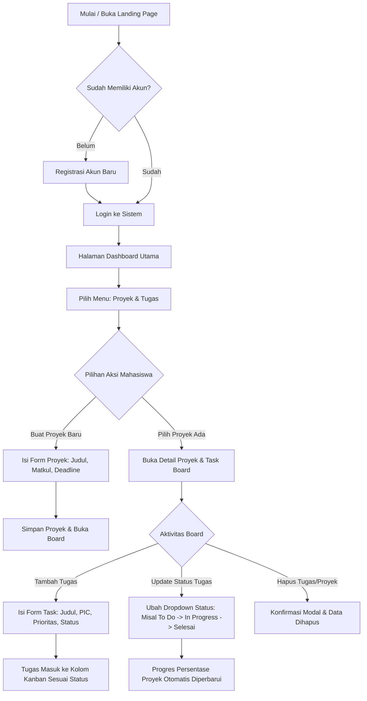

# PRODUCT REQUIREMENTS DOCUMENT (PRD)
## EduTask – Sistem Manajemen Tugas & Kolaborasi Proyek Mahasiswa

---

### Informasi Dokumen
- **Nama Proyek**: EduTask (Student Project & Task Management System)
- **Kategori**: Web-Based Collaborative Project Management
- **Versi Dokumen**: 1.0.0 (Tahap 1: Inisiasi Proyek & Persiapan Lingkungan)
- **Status Dokumen**: Disetujui (Approved for Development)
- **Technology Stack**: Laravel 12 (Backend), Vue.js 3 (Frontend), Inertia.js (Bridge), Tailwind CSS (UI Styling), SQLite/MySQL (Database)
- **Target Platform**: Responsive Web Application (Desktop, Tablet, Mobile)

---

## 1. Latar Belakang dan Permasalahan

### 1.1 Latar Belakang
Dalam kegiatan perkuliahan perguruan tinggi, mahasiswa dituntut untuk menyelesaikan berbagai tugas akhir dan tugas besar berbasis proyek secara berkelompok. Keberhasilan penyelesaian proyek kelompok sangat bergantung pada koordinasi tim, pembagian tugas yang adil, pemantauan tenggat waktu (deadline), dan transparansi progres kerja antar anggota.

### 1.2 Identifikasi Masalah
Berdasarkan observasi pada kelompok mahasiswa dan sistem asistensi praktikum/proyek, ditemukan beberapa permasalahan utama:
1. **Delegasi Tugas yang Tidak Terstruktur**: Pembagian tugas sering dilakukan hanya melalui aplikasi pesan instan (WhatsApp/Telegram) tanpa dokumentasi resmi, menyebabkan tugas sering terlewat atau terjadi tumpang tindih pengerjaan (*overlapping*).
2. **Kurangnya Visibilitas Progres**: Ketua kelompok dan anggota kesulitan mengetahui progres riil dari masing-masing tugas hingga mendekati batas waktu pengumpulan (*procrastination* & kepanikan menjelang deadline).
3. **Ketidakseimbangan Kontribusi**: Tidak adanya rekam jejak aktivitas digital yang objektif terkait kontribusi setiap anggota kelompok dalam menyelesaikan *deliverables*.
4. **Kesulitan Evaluasi bagi Dosen & Asisten**: Dosen atau asisten praktikum kesulitan melakukan penilaian proses secara objektif karena hanya melihat hasil akhir, bukan dinamika kolaborasi kelompok.

---

## 2. Tujuan dan Deskripsi Aplikasi

### 2.1 Tujuan Proyek
1. Menyediakan platform terpusat bagi kelompok mahasiswa untuk merencanakan, mendistribusikan, dan memantau tugas proyek akademik secara terstruktur.
2. Meningkatkan transparansi dan akuntabilitas pengerjaan tugas setiap anggota tim melalui papan kerja (*Kanban Task Board*).
3. Memberikan representasi visual perkembangan proyek melalui indikator progres otomatis (*percentage progress bar*).
4. Menjadi fondasi implementasi teknologi modern *Single Page Application* (SPA) menggunakan arsitektur monolitik terpadu **Laravel 12 + Vue.js 3 + Inertia.js**.

### 2.2 Deskripsi Aplikasi
**EduTask** adalah aplikasi manajemen proyek dan papan penugasan kolaboratif berbasis web yang dirancang khusus untuk lingkungan akademik mahasiswa. EduTask memungkinkan mahasiswa membuat proyek berdasarkan mata kuliah, membagi tugas ke dalam tahapan kerja (*To Do*, *In Progress*, *Review*, *Completed*), menetapkan tingkat prioritas, menunjuk penanggung jawab spesifik, dan memantau persentase penyelesaian secara interaktif tanpa *page reload* berkat integrasi Inertia.js.

---

## 3. Target Pengguna & User Persona

| Peran Pengguna | Deskripsi & Tanggung Jawab | Kebutuhan Utama |
| :--- | :--- | :--- |
| **Ketua Tim / Project Leader (Mahasiswa)** | Memimpin kelompok, membuat proyek, memecah *milestone*, menetapkan penanggung jawab tugas, dan memantau deadline keseluruhan. | Kemudahan membuat proyek, membagi tugas secara terperinci, melihat rekap persentase selesai, dan menghapus/mengubah tugas. |
| **Anggota Tim (Mahasiswa)** | Melaksanakan tugas yang didelegasikan, memperbarui status pengerjaan, dan memeriksa prioritas pekerjaan. | Antarmuka Kanban yang intuitif, fitur pemindahan status tugas instan, kejelasan instruksi, dan batas waktu pengerjaan. |
| **Dosen / Asisten Praktikum** | Memeriksa kepatuhan proyek, melihat distribusi kontribusi anggota tim, dan mengevaluasi hasil pengerjaan. | Tampilan rekapitulasi proyek yang rapi, transparan, dan mudah diakses melalui akun peninjau (*reviewer*). |

---

## 4. Identifikasi Kebutuhan & Fitur Utama

### 4.1 Ruang Lingkup Tahap 1 (Inisiasi & Rilis Awal - Selesai)
1. **Inisiasi Proyek & Konfigurasi Stack**:
   - Integrasi Laravel 12 + Vue.js 3 + Inertia.js + Tailwind CSS.
   - Konfigurasi Vite *asset bundling* dan *environment* database lokal (SQLite/MySQL).
2. **Sistem Autentikasi Pengguna**:
   - Pendaftaran akun (*Register*), Masuk akun (*Login*), dan Pengelolaan Profil (*Edit Profile*).
3. **Manajemen Proyek (Project Management)**:
   - Pembuatan proyek baru (Judul, Mata Kuliah, Status, Tenggat Waktu, Deskripsi).
   - Filter dan pencarian proyek berdasarkan status (*Planning, In Progress, Completed, On Hold*) dan kata kunci.
   - Penghitungan otomatis persentase progres proyek berdasarkan rasio tugas selesai.
4. **Papan Tugas Interaktif (Interactive Kanban Task Board)**:
   - Pembagian tugas ke dalam 4 kolom status: *To Do*, *In Progress*, *Review*, *Completed*.
   - Pembuatan tugas baru dengan penanggung jawab (*assigned member*), tenggat waktu, dan tingkat prioritas (*Low, Medium, High, Urgent*).
   - Pengubahan status tugas secara instan melalui dropdown status tanpa *reload* halaman.
   - Penghapusan tugas dengan modal konfirmasi keamanan.
5. **Dashboard Analitik Sederhana**:
   - Ringkasan metrik proyek aktif, total tugas, tugas selesai, dan tugas tertunda.
   - Tabel tugas terbaru untuk memudahkan akses cepat.

### 4.2 Roadmap Fitur Tahap Selanjutnya (Tahap 2 & Tahap 3)
- **Tahap 2 (Ekspansi Fitur)**:
  - *Drag-and-drop* interaktif pada kolom papan Kanban.
  - Unggah lampiran berkas (*file attachments*) dan tautan Google Docs/Drive pada tiap kartu tugas.
  - Kolom komentar dan diskusi real-time pada detail tugas.
  - Notifikasi *in-app* ketika mendekati batas waktu pengerjaan (*deadline reminder*).
- **Tahap 3 (Penyempurnaan & Pelaporan)**:
  - Ekspor laporan rekapitulasi proyek kelompok ke format PDF/Excel untuk pengumpulan laporan akhir praktikum.
  - Grafik produktivitas anggota tim (*burn-down chart*).
  - *Role-based access control* (RBAC) lanjutan untuk Hak Akses Dosen Pembimbing.

---

## 5. User Flow / Alur Penggunaan Aplikasi

### 5.1 Alur Penggunaan Umum


### 5.2 Alur Pembaruan Status Tugas (Inertia State Flow)
1. Pengguna berada pada halaman `Projects/Show.vue`.
2. Pengguna memilih opsi status baru pada elemen `<select>` di kartu tugas (misalnya memindahkan tugas dari *In Progress* ke *Completed*).
3. Vue mengirim *request* HTTP PATCH ke endpoint `/tasks/{task}` menggunakan `router.patch()`.
4. Laravel Controller memvalidasi input, memperbarui database, dan mengembalikan respons Inertia.
5. Inertia secara otomatis memperbarui *props* komponen secara reaktif di sisi klien tanpa me-refresh seluruh halaman browser.
6. Progress bar proyek langsung bertambah secara visual seketika.

---

## 6. Kebutuhan Fungsional & Non-Fungsional

### 6.1 Kebutuhan Fungsional (Functional Requirements)

| Kode | Kategori | Deskripsi Kebutuhan |
| :--- | :--- | :--- |
| **FR-01** | Autentikasi | Sistem harus memungkinkan pengguna mendaftarkan akun baru dengan nama, email, dan kata sandi yang terenkripsi. |
| **FR-02** | Autentikasi | Sistem harus memvalidasi kredensial pengguna saat login dan membatasi sesi kerja tidak sah. |
| **FR-03** | Autentikasi | Pengguna dapat memperbarui informasi profil dan mengubah kata sandi. |
| **FR-04** | Dashboard | Sistem harus menampilkan rekapitulasi data: jumlah total proyek, proyek berjalan, proyek selesai, dan metrik tugas. |
| **FR-05** | Manajemen Proyek | Pengguna dapat membuat proyek baru dengan memasukkan judul, mata kuliah, deskripsi, status, dan target selesai. |
| **FR-06** | Manajemen Proyek | Sistem harus menampilkan daftar proyek dengan pagination, filter status, dan fungsi pencarian teks. |
| **FR-07** | Manajemen Proyek | Pengguna dapat memperbarui informasi detail proyek dan mengubah status proyek. |
| **FR-08** | Manajemen Proyek | Pengguna dapat menghapus proyek beserta seluruh data tugas terkait (*cascade delete*). |
| **FR-09** | Manajemen Tugas | Pengguna dapat menambahkan tugas baru di bawah proyek tertentu dengan atribut: judul, penanggung jawab, prioritas, status, batas waktu, dan deskripsi. |
| **FR-10** | Manajemen Tugas | Sistem harus mengelompokkan tugas ke dalam 4 kolom visual: *To Do*, *In Progress*, *Review*, dan *Completed*. |
| **FR-11** | Manajemen Tugas | Pengguna dapat mengubah status pengerjaan tugas secara instan melalui dropdown status tanpa *page refresh*. |
| **FR-12** | Manajemen Tugas | Sistem harus menghitung rasio tugas selesai berbanding total tugas dan menghasilkan persentase progres proyek secara real-time. |
| **FR-13** | Manajemen Tugas | Pengguna dapat menghapus tugas yang tidak diperlukan dengan dialog konfirmasi. |
| **FR-14** | Seeder & Demo | Sistem harus menyediakan akun demo dan data sampel proyek/tugas bawaan (*seeded data*) untuk kemudahan evaluasi penguji. |

### 6.2 Kebutuhan Non-Fungsional (Non-Functional Requirements)

| Kode | Parameter | Spesifikasi & Standar |
| :--- | :--- | :--- |
| **NFR-01** | *Performance* | Waktu respon halaman (FCP & LCP) di bawah 1.5 detik pada lingkungan lokal. Aset CSS/JS di-bundle dan di-minifikasi menggunakan Vite. |
| **NFR-02** | *Responsiveness* | Tampilan antarmuka harus responsif dan adaptif pada berbagai resolusi layar (Desktop $\ge$ 1024px, Tablet 768px, Mobile 360px) memanfaatkan Tailwind CSS. |
| **NFR-03** | *Security* | Proteksi CSRF (*Cross-Site Request Forgery*) pada seluruh HTTP method non-GET melalui middleware bawaan Laravel/Inertia. Enkripsi kata sandi menggunakan algoritma Bcrypt/Argon2. |
| **NFR-04** | *Usability* | Antarmuka pengguna (*UI/UX*) intuitif dengan penanda status warna standar (Hijau = Selesai, Kuning/Oranye = Berjalan, Biru = Perencanaan, Merah = Mendesak). |
| **NFR-05** | *Maintainability* | Kode program mematuhi standar PSR-12 untuk PHP dan Vue 3 Composition API `<script setup>` yang modular dan reusable. |
| **NFR-06** | *Portability* | Database menggunakan SQLite secara default sehingga penguji/dosen tidak perlu konfigurasi server basis data eksternal untuk menjalankan aplikasi, dengan kemudahan beralih ke MySQL via `.env`. |

---

## 7. Gambaran Awal Antarmuka Aplikasi (Wireframe & Layout)

### 7.1 Struktur Halaman Utama (Landing Page / `Welcome.vue`)
```text
+--------------------------------------------------------------------------+
|  [Logo EduTask]  EduTask (Tahap 1)                     [Masuk] [Daftar]  |
+--------------------------------------------------------------------------+
|                                                                          |
|       [Badge: Tugas Proyek Akhir • Tahap 1: Inisiasi Proyek & Stack]     |
|                                                                          |
|       Kelola Proyek & Tugas Akademik Bersama EduTask                     |
|       Platform kolaborasi modern mahasiswa berbasis Laravel 12 + Vue 3   |
|                                                                          |
|   [Laravel 12]  [Vue.js 3]  [Inertia.js]  [Tailwind CSS]  [SQLite/MySQL]  |
|                                                                          |
|                  [ Masuk ke Aplikasi ]   [ Petunjuk Akun Demo ]          |
|                                                                          |
+--------------------------------------------------------------------------+
|  [KOTAK AKUN DEMO PENGUJIAN DOSEN & ASISTEN]                             |
|  - Ketua Tim: budi@edutask.test (password: password)                     |
|  - Anggota 1: siti@edutask.test (password: password)                     |
|  - Anggota 2: ahmad@edutask.test (password: password)                    |
+--------------------------------------------------------------------------+
|  [KARTU 1: Tech Stack]   |   [KARTU 2: PRD.md]   |   [KARTU 3: Fitur]    |
+--------------------------------------------------------------------------+
|  Footer: EduTask • Tugas Proyek Akhir Tahap 1                            |
+--------------------------------------------------------------------------+
```

### 7.2 Struktur Papan Tugas Kanban (`Projects/Show.vue`)
```text
+--------------------------------------------------------------------------+
| < Semua Proyek  /  EduTask: Sistem Manajemen Tugas                       |
|                                                                          |
| Judul Proyek: EduTask [Sedang Berjalan]           [Edit Info] [+ Tugas]  |
| Matkul: Proyek Perangkat Lunak | Deadline: 19 Des 2026                   |
+--------------------------------------------------------------------------+
| Progress Bar: [===============================>--------] 62% (5/8 Tugas)  |
+--------------------------------------------------------------------------+
| [ TO DO (2) ]     | [ IN PROGRESS (2) ] | [ REVIEW (1) ]  | [ SELESAI (3) ] |
|-------------------+---------------------+-----------------+-----------------|
| [Kartu Tugas #1]  | [Kartu Tugas #3]    | [Kartu Tugas #5]| [Kartu Tugas #6]|
| Prioritas: Sedang | Prioritas: Mendesak | Prioritas:Sedang| Prioritas:Tinggi|
| PIC: Siti         | PIC: Budi           | PIC: Ahmad      | PIC: Budi       |
| Move: [Select v]  | Move: [Select v]    | Move: [Select v]| Move: [Select v]|
|-------------------+---------------------+-----------------+-----------------|
| [Kartu Tugas #2]  | [Kartu Tugas #4]    |                 | [Kartu Tugas #7]|
| Prioritas: Rendah | Prioritas: Tinggi   |                 | PIC: Siti       |
| PIC: Ahmad        | PIC: Siti           |                 | Move: [Select v]|
+--------------------------------------------------------------------------+
```

---

## 8. Arsitektur Teknologi & Model Data

### 8.1 Arsitektur Sistem
```
+-----------------------------------------------------------------------+
|                            CLIENT BROWSER                             |
|  Vue.js 3 Single Page Application (Components, Pages, Composition API) |
+-----------------------------------------------------------------------+
                                  │   ▲
                       Inertia.js │   │ Props / JSON State
                                  ▼   │
+-----------------------------------------------------------------------+
|                            BACKEND SERVER                             |
|  Laravel 12 Framework (Routing, Controllers, Eloquent ORM, Auth)      |
+-----------------------------------------------------------------------+
                                  │   ▲
                     PDO / SQLite │   │ SQL Queries
                                  ▼   │
+-----------------------------------------------------------------------+
|                            DATABASE LAYER                             |
|  database.sqlite (users, projects, tasks, sessions, cache)            |
+-----------------------------------------------------------------------+
```

### 8.2 Skema Entitas Database (ERD Singkat)
1. **users**:
   - `id`: PK (bigint unsigned)
   - `name`: string(255)
   - `email`: string(255) unique
   - `password`: string(255)
   - `timestamps`
2. **projects**:
   - `id`: PK (bigint unsigned)
   - `user_id`: FK -> users.id (cascade on delete)
   - `title`: string(255)
   - `course_name`: string(255) nullable
   - `description`: text nullable
   - `status`: enum('planning', 'in_progress', 'completed', 'on_hold')
   - `due_date`: date nullable
   - `timestamps`
3. **tasks**:
   - `id`: PK (bigint unsigned)
   - `project_id`: FK -> projects.id (cascade on delete)
   - `user_id`: FK -> users.id nullable (null on delete)
   - `assigned_name`: string(255) nullable
   - `title`: string(255)
   - `description`: text nullable
   - `priority`: enum('low', 'medium', 'high', 'urgent')
   - `status`: enum('todo', 'in_progress', 'review', 'completed')
   - `due_date`: date nullable
   - `timestamps`

---

## 9. Pedoman Pemanfaatan Artificial Intelligence (AI Coding Tools)

Dokumen PRD ini dirancang untuk menjadi pedoman utama (*system context*) bagi tim saat berinteraksi dengan AI Coding Tools (seperti Antigravity AI, GitHub Copilot, Gemini Code Assist, atau Cursor). 

### 9.1 Konvensi Pemberian Instruksi (Prompting Framework)
Setiap anggota tim yang memanfaatkan AI coding wajib menyertakan konteks dari PRD ini dengan format standar:
```markdown
[ROLE]: Anda adalah Senior Full-Stack Engineer ahli Laravel 12 dan Vue.js 3 dengan Inertia.js.
[CONTEXT]: Kami sedang mengembangkan aplikasi EduTask sesuai PRD.md (fitur papan tugas kolaboratif mahasiswa).
[TASK]: <Tuliskan instruksi spesifik, misal: membuat komponen modal edit tugas atau menambahkan validasi form>.
[CONSTRAINTS]:
- Gunakan Vue 3 Composition API dengan <script setup>.
- Gunakan Tailwind CSS untuk styling sesuai skema warna yang ditentukan di PRD.md.
- Pastikan interaksi data ke server menggunakan form helper dari @inertiajs/vue3.
- Pastikan tidak memicu full page reload.
```

### 9.2 Prinsip Integritas dan Kontrol Kualitas AI
1. **Verifikasi Mandiri**: Seluruh kode yang di-generate oleh AI harus di-review, diuji, dan dipahami alurnya oleh anggota tim sebelum di-commit ke Git.
2. **Kesesuaian Dokumen**: Kode buatan AI tidak boleh menyimpang dari skema database dan spesifikasi kebutuhan (FR/NFR) yang telah disepakati dalam `PRD.md`.
3. **Pengujian Terotomatisasi**: Setiap penambahan fitur yang dibantu AI harus didukung oleh pengujian fungsional (*Feature Test*) menggunakan PHPUnit/Pest.
